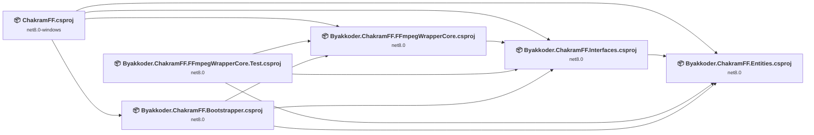
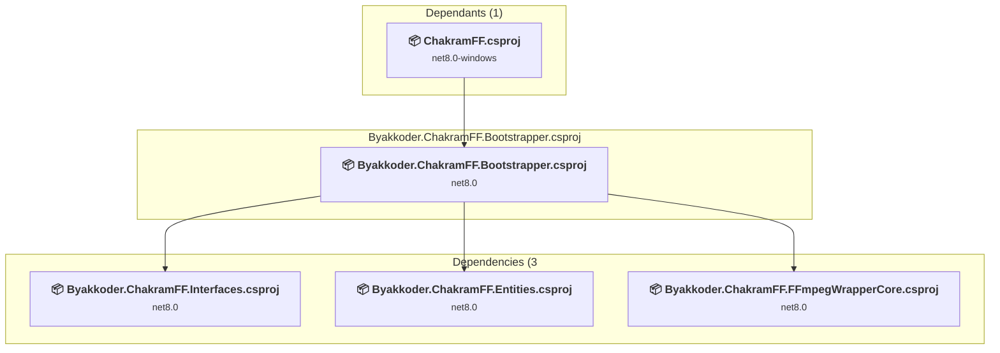
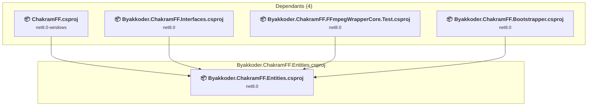
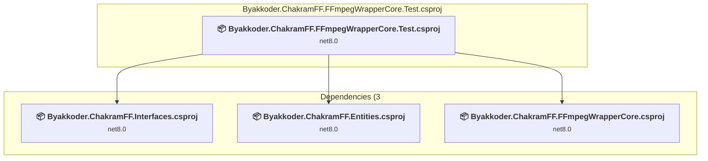
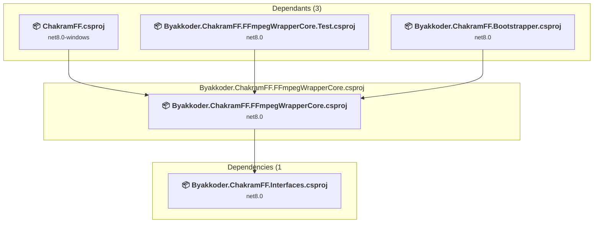
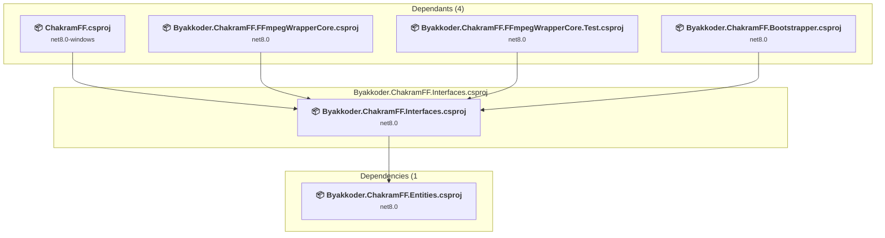
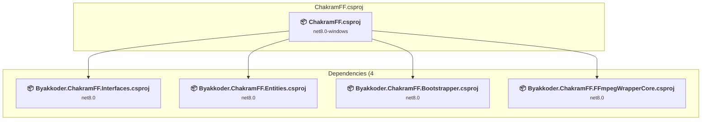

# Projects and dependencies analysis

This document provides a comprehensive overview of the projects and their dependencies in the context of upgrading to .NETCoreApp,Version=v10.0.

## Table of Contents

- [Executive Summary](#executive-Summary)
  - [Highlevel Metrics](#highlevel-metrics)
  - [Projects Compatibility](#projects-compatibility)
  - [Package Compatibility](#package-compatibility)
  - [API Compatibility](#api-compatibility)
- [Aggregate NuGet packages details](#aggregate-nuget-packages-details)
- [Top API Migration Challenges](#top-api-migration-challenges)
  - [Technologies and Features](#technologies-and-features)
  - [Most Frequent API Issues](#most-frequent-api-issues)
- [Projects Relationship Graph](#projects-relationship-graph)
- [Project Details](#project-details)

  - [Byakkoder.ChakramFF.Bootstrapper\Byakkoder.ChakramFF.Bootstrapper.csproj](#byakkoderchakramffbootstrapperbyakkoderchakramffbootstrappercsproj)
  - [Byakkoder.ChakramFF.Entities\Byakkoder.ChakramFF.Entities.csproj](#byakkoderchakramffentitiesbyakkoderchakramffentitiescsproj)
  - [Byakkoder.ChakramFF.FFmpegWrapperCore.Test\Byakkoder.ChakramFF.FFmpegWrapperCore.Test.csproj](#byakkoderchakramffffmpegwrappercoretestbyakkoderchakramffffmpegwrappercoretestcsproj)
  - [Byakkoder.ChakramFF.FFmpegWrapperCore\Byakkoder.ChakramFF.FFmpegWrapperCore.csproj](#byakkoderchakramffffmpegwrappercorebyakkoderchakramffffmpegwrappercorecsproj)
  - [Byakkoder.ChakramFF.Interfaces\Byakkoder.ChakramFF.Interfaces.csproj](#byakkoderchakramffinterfacesbyakkoderchakramffinterfacescsproj)
  - [ChakramFF\ChakramFF.csproj](#chakramffchakramffcsproj)

## Executive Summary

### Highlevel Metrics

| Metric | Count | Status |
| :--- | :---: | :--- |
| Total Projects | 6 | All require upgrade |
| Total NuGet Packages | 10 | 2 need upgrade |
| Total Code Files | 173 |  |
| Total Code Files with Incidents | 36 |  |
| Total Lines of Code | 14477 |  |
| Total Number of Issues | 4694 |  |
| Estimated LOC to modify | 4685+ | at least 32,4% of codebase |

### Projects Compatibility

| Project | Target Framework | Difficulty | Package Issues | API Issues | Est. LOC Impact | Description |
| :--- | :---: | :---: | :---: | :---: | :---: | :--- |
| [Byakkoder.ChakramFF.Bootstrapper\Byakkoder.ChakramFF.Bootstrapper.csproj](#byakkoderchakramffbootstrapperbyakkoderchakramffbootstrappercsproj) | net8.0 | 🟢 Low | 1 | 0 |  | ClassLibrary, Sdk Style = True |
| [Byakkoder.ChakramFF.Entities\Byakkoder.ChakramFF.Entities.csproj](#byakkoderchakramffentitiesbyakkoderchakramffentitiescsproj) | net8.0 | 🟢 Low | 0 | 0 |  | ClassLibrary, Sdk Style = True |
| [Byakkoder.ChakramFF.FFmpegWrapperCore.Test\Byakkoder.ChakramFF.FFmpegWrapperCore.Test.csproj](#byakkoderchakramffffmpegwrappercoretestbyakkoderchakramffffmpegwrappercoretestcsproj) | net8.0 | 🟢 Low | 0 | 1 | 1+ | DotNetCoreApp, Sdk Style = True |
| [Byakkoder.ChakramFF.FFmpegWrapperCore\Byakkoder.ChakramFF.FFmpegWrapperCore.csproj](#byakkoderchakramffffmpegwrappercorebyakkoderchakramffffmpegwrappercorecsproj) | net8.0 | 🟢 Low | 0 | 1 | 1+ | ClassLibrary, Sdk Style = True |
| [Byakkoder.ChakramFF.Interfaces\Byakkoder.ChakramFF.Interfaces.csproj](#byakkoderchakramffinterfacesbyakkoderchakramffinterfacescsproj) | net8.0 | 🟢 Low | 0 | 0 |  | ClassLibrary, Sdk Style = True |
| [ChakramFF\ChakramFF.csproj](#chakramffchakramffcsproj) | net8.0-windows | 🟡 Medium | 2 | 4683 | 4683+ | WinForms, Sdk Style = True |

### Package Compatibility

| Status | Count | Percentage |
| :--- | :---: | :---: |
| ✅ Compatible | 8 | 80,0% |
| ⚠️ Incompatible | 0 | 0,0% |
| 🔄 Upgrade Recommended | 2 | 20,0% |
| ***Total NuGet Packages*** | ***10*** | ***100%*** |

### API Compatibility

| Category | Count | Impact |
| :--- | :---: | :--- |
| 🔴 Binary Incompatible | 4146 | High - Require code changes |
| 🟡 Source Incompatible | 539 | Medium - Needs re-compilation and potential conflicting API error fixing |
| 🔵 Behavioral change | 0 | Low - Behavioral changes that may require testing at runtime |
| ✅ Compatible | 7829 |  |
| ***Total APIs Analyzed*** | ***12514*** |  |

## Aggregate NuGet packages details

| Package | Current Version | Suggested Version | Projects | Description |
| :--- | :---: | :---: | :--- | :--- |
| coverlet.collector | 6.0.0 |  | [Byakkoder.ChakramFF.FFmpegWrapperCore.Test.csproj](#byakkoderchakramffffmpegwrappercoretestbyakkoderchakramffffmpegwrappercoretestcsproj) | ✅Compatible |
| Microsoft.CSharp | 4.7.0 |  | [ChakramFF.csproj](#chakramffchakramffcsproj) | ✅Compatible |
| Microsoft.Extensions.Hosting | 8.0.0 | 10.0.1 | [Byakkoder.ChakramFF.Bootstrapper.csproj](#byakkoderchakramffbootstrapperbyakkoderchakramffbootstrappercsproj) | NuGet package upgrade is recommended |
| Microsoft.NET.Test.Sdk | 17.8.0 |  | [Byakkoder.ChakramFF.FFmpegWrapperCore.Test.csproj](#byakkoderchakramffffmpegwrappercoretestbyakkoderchakramffffmpegwrappercoretestcsproj) | ✅Compatible |
| Moq | 4.20.70 |  | [Byakkoder.ChakramFF.FFmpegWrapperCore.Test.csproj](#byakkoderchakramffffmpegwrappercoretestbyakkoderchakramffffmpegwrappercoretestcsproj) | ✅Compatible |
| MSTest.TestAdapter | 3.1.1 |  | [Byakkoder.ChakramFF.FFmpegWrapperCore.Test.csproj](#byakkoderchakramffffmpegwrappercoretestbyakkoderchakramffffmpegwrappercoretestcsproj) | ✅Compatible |
| MSTest.TestFramework | 3.1.1 |  | [Byakkoder.ChakramFF.FFmpegWrapperCore.Test.csproj](#byakkoderchakramffffmpegwrappercoretestbyakkoderchakramffffmpegwrappercoretestcsproj) | ✅Compatible |
| System.Data.DataSetExtensions | 4.5.0 |  | [ChakramFF.csproj](#chakramffchakramffcsproj) | NuGet package functionality is included with framework reference |
| System.Runtime.CompilerServices.Unsafe | 6.0.0 | 6.1.2 | [ChakramFF.csproj](#chakramffchakramffcsproj) | NuGet package upgrade is recommended |
| Unity | 5.11.7 |  | [ChakramFF.csproj](#chakramffchakramffcsproj) | ✅Compatible |

## Top API Migration Challenges

### Technologies and Features

| Technology | Issues | Percentage | Migration Path |
| :--- | :---: | :---: | :--- |
| Windows Forms | 4146 | 88,5% | Windows Forms APIs for building Windows desktop applications with traditional Forms-based UI that are available in .NET on Windows. Enable Windows Desktop support: Option 1 (Recommended): Target net9.0-windows; Option 2: Add <UseWindowsDesktop>true</UseWindowsDesktop>; Option 3 (Legacy): Use Microsoft.NET.Sdk.WindowsDesktop SDK. |
| GDI+ / System.Drawing | 533 | 11,4% | System.Drawing APIs for 2D graphics, imaging, and printing that are available via NuGet package System.Drawing.Common. Note: Not recommended for server scenarios due to Windows dependencies; consider cross-platform alternatives like SkiaSharp or ImageSharp for new code. |
| Legacy Configuration System | 4 | 0,1% | Legacy XML-based configuration system (app.config/web.config) that has been replaced by a more flexible configuration model in .NET Core. The old system was rigid and XML-based. Migrate to Microsoft.Extensions.Configuration with JSON/environment variables; use System.Configuration.ConfigurationManager NuGet package as interim bridge if needed. |

### Most Frequent API Issues

| API | Count | Percentage | Category |
| :--- | :---: | :---: | :--- |
| T:System.Windows.Forms.Button | 503 | 10,7% | Binary Incompatible |
| T:System.Windows.Forms.Panel | 358 | 7,6% | Binary Incompatible |
| T:System.Windows.Forms.AnchorStyles | 279 | 6,0% | Binary Incompatible |
| T:System.Windows.Forms.Label | 154 | 3,3% | Binary Incompatible |
| T:System.Windows.Forms.TextBox | 119 | 2,5% | Binary Incompatible |
| T:System.Windows.Forms.Padding | 100 | 2,1% | Binary Incompatible |
| T:System.Drawing.Font | 98 | 2,1% | Source Incompatible |
| T:System.Drawing.FontStyle | 92 | 2,0% | Source Incompatible |
| P:System.Windows.Forms.Control.Name | 91 | 1,9% | Binary Incompatible |
| T:System.Windows.Forms.Control.ControlCollection | 90 | 1,9% | Binary Incompatible |
| P:System.Windows.Forms.Control.Controls | 90 | 1,9% | Binary Incompatible |
| T:System.Windows.Forms.FlatStyle | 90 | 1,9% | Binary Incompatible |
| P:System.Windows.Forms.Control.Size | 88 | 1,9% | Binary Incompatible |
| T:System.Drawing.GraphicsUnit | 88 | 1,9% | Source Incompatible |
| M:System.Windows.Forms.Control.ControlCollection.Add(System.Windows.Forms.Control) | 82 | 1,8% | Binary Incompatible |
| P:System.Windows.Forms.Control.Location | 80 | 1,7% | Binary Incompatible |
| P:System.Windows.Forms.Control.TabIndex | 76 | 1,6% | Binary Incompatible |
| T:System.Windows.Forms.DockStyle | 72 | 1,5% | Binary Incompatible |
| T:System.Windows.Forms.MouseEventHandler | 60 | 1,3% | Binary Incompatible |
| T:System.Drawing.Bitmap | 55 | 1,2% | Source Incompatible |
| P:System.Windows.Forms.Control.Font | 49 | 1,0% | Binary Incompatible |
| P:System.Windows.Forms.Control.Anchor | 45 | 1,0% | Binary Incompatible |
| P:System.Windows.Forms.Control.Margin | 44 | 0,9% | Binary Incompatible |
| F:System.Drawing.GraphicsUnit.Point | 44 | 0,9% | Source Incompatible |
| M:System.Drawing.Font.#ctor(System.String,System.Single,System.Drawing.FontStyle,System.Drawing.GraphicsUnit,System.Byte) | 44 | 0,9% | Source Incompatible |
| T:System.Windows.Forms.Cursor | 44 | 0,9% | Binary Incompatible |
| F:System.Windows.Forms.AnchorStyles.Right | 42 | 0,9% | Binary Incompatible |
| P:System.Windows.Forms.Control.ForeColor | 41 | 0,9% | Binary Incompatible |
| F:System.Windows.Forms.AnchorStyles.Top | 40 | 0,9% | Binary Incompatible |
| T:System.Windows.Forms.CheckBox | 40 | 0,9% | Binary Incompatible |
| T:System.Windows.Forms.DialogResult | 37 | 0,8% | Binary Incompatible |
| T:System.Windows.Forms.AutoScaleMode | 33 | 0,7% | Binary Incompatible |
| T:System.Drawing.ContentAlignment | 33 | 0,7% | Source Incompatible |
| M:System.Windows.Forms.Padding.#ctor(System.Int32,System.Int32,System.Int32,System.Int32) | 32 | 0,7% | Binary Incompatible |
| F:System.Drawing.FontStyle.Regular | 31 | 0,7% | Source Incompatible |
| F:System.Windows.Forms.FlatStyle.Flat | 30 | 0,6% | Binary Incompatible |
| T:System.Windows.Forms.BorderStyle | 30 | 0,6% | Binary Incompatible |
| P:System.Windows.Forms.ButtonBase.UseVisualStyleBackColor | 29 | 0,6% | Binary Incompatible |
| P:System.Windows.Forms.ButtonBase.FlatStyle | 29 | 0,6% | Binary Incompatible |
| T:System.Windows.Forms.PictureBox | 29 | 0,6% | Binary Incompatible |
| M:System.Windows.Forms.Button.#ctor | 27 | 0,6% | Binary Incompatible |
| E:System.Windows.Forms.Control.Click | 26 | 0,6% | Binary Incompatible |
| T:System.Windows.Forms.FormWindowState | 26 | 0,6% | Binary Incompatible |
| P:System.Windows.Forms.Control.Enabled | 25 | 0,5% | Binary Incompatible |
| P:System.Windows.Forms.ButtonBase.Text | 24 | 0,5% | Binary Incompatible |
| F:System.Windows.Forms.AnchorStyles.Left | 24 | 0,5% | Binary Incompatible |
| P:System.Windows.Forms.Control.Dock | 24 | 0,5% | Binary Incompatible |
| P:System.Windows.Forms.Form.Size | 24 | 0,5% | Binary Incompatible |
| P:System.Windows.Forms.ButtonBase.BackColor | 23 | 0,5% | Binary Incompatible |
| M:System.Windows.Forms.Panel.#ctor | 23 | 0,5% | Binary Incompatible |

## Projects Relationship Graph

Legend:
📦 SDK-style project
⚙️ Classic project

## Project Details

### Byakkoder.ChakramFF.Bootstrapper\Byakkoder.ChakramFF.Bootstrapper.csproj

#### Project Info

- **Current Target Framework:** net8.0
- **Proposed Target Framework:** net10.0
- **SDK-style**: True
- **Project Kind:** ClassLibrary
- **Dependencies**: 3
- **Dependants**: 1
- **Number of Files**: 1
- **Number of Files with Incidents**: 1
- **Lines of Code**: 128
- **Estimated LOC to modify**: 0+ (at least 0,0% of the project)

#### Dependency Graph

Legend:
📦 SDK-style project
⚙️ Classic project

### API Compatibility

| Category | Count | Impact |
| :--- | :---: | :--- |
| 🔴 Binary Incompatible | 0 | High - Require code changes |
| 🟡 Source Incompatible | 0 | Medium - Needs re-compilation and potential conflicting API error fixing |
| 🔵 Behavioral change | 0 | Low - Behavioral changes that may require testing at runtime |
| ✅ Compatible | 148 |  |
| ***Total APIs Analyzed*** | ***148*** |  |

### Byakkoder.ChakramFF.Entities\Byakkoder.ChakramFF.Entities.csproj

#### Project Info

- **Current Target Framework:** net8.0
- **Proposed Target Framework:** net10.0
- **SDK-style**: True
- **Project Kind:** ClassLibrary
- **Dependencies**: 0
- **Dependants**: 4
- **Number of Files**: 26
- **Number of Files with Incidents**: 1
- **Lines of Code**: 1329
- **Estimated LOC to modify**: 0+ (at least 0,0% of the project)

#### Dependency Graph

Legend:
📦 SDK-style project
⚙️ Classic project

### API Compatibility

| Category | Count | Impact |
| :--- | :---: | :--- |
| 🔴 Binary Incompatible | 0 | High - Require code changes |
| 🟡 Source Incompatible | 0 | Medium - Needs re-compilation and potential conflicting API error fixing |
| 🔵 Behavioral change | 0 | Low - Behavioral changes that may require testing at runtime |
| ✅ Compatible | 773 |  |
| ***Total APIs Analyzed*** | ***773*** |  |

### Byakkoder.ChakramFF.FFmpegWrapperCore.Test\Byakkoder.ChakramFF.FFmpegWrapperCore.Test.csproj

#### Project Info

- **Current Target Framework:** net8.0
- **Proposed Target Framework:** net10.0
- **SDK-style**: True
- **Project Kind:** DotNetCoreApp
- **Dependencies**: 3
- **Dependants**: 0
- **Number of Files**: 36
- **Number of Files with Incidents**: 2
- **Lines of Code**: 3899
- **Estimated LOC to modify**: 1+ (at least 0,0% of the project)

#### Dependency Graph

Legend:
📦 SDK-style project
⚙️ Classic project

### API Compatibility

| Category | Count | Impact |
| :--- | :---: | :--- |
| 🔴 Binary Incompatible | 0 | High - Require code changes |
| 🟡 Source Incompatible | 1 | Medium - Needs re-compilation and potential conflicting API error fixing |
| 🔵 Behavioral change | 0 | Low - Behavioral changes that may require testing at runtime |
| ✅ Compatible | 2366 |  |
| ***Total APIs Analyzed*** | ***2367*** |  |

### Byakkoder.ChakramFF.FFmpegWrapperCore\Byakkoder.ChakramFF.FFmpegWrapperCore.csproj

#### Project Info

- **Current Target Framework:** net8.0
- **Proposed Target Framework:** net10.0
- **SDK-style**: True
- **Project Kind:** ClassLibrary
- **Dependencies**: 1
- **Dependants**: 3
- **Number of Files**: 44
- **Number of Files with Incidents**: 2
- **Lines of Code**: 3127
- **Estimated LOC to modify**: 1+ (at least 0,0% of the project)

#### Dependency Graph

Legend:
📦 SDK-style project
⚙️ Classic project

### API Compatibility

| Category | Count | Impact |
| :--- | :---: | :--- |
| 🔴 Binary Incompatible | 0 | High - Require code changes |
| 🟡 Source Incompatible | 1 | Medium - Needs re-compilation and potential conflicting API error fixing |
| 🔵 Behavioral change | 0 | Low - Behavioral changes that may require testing at runtime |
| ✅ Compatible | 1359 |  |
| ***Total APIs Analyzed*** | ***1360*** |  |

### Byakkoder.ChakramFF.Interfaces\Byakkoder.ChakramFF.Interfaces.csproj

#### Project Info

- **Current Target Framework:** net8.0
- **Proposed Target Framework:** net10.0
- **SDK-style**: True
- **Project Kind:** ClassLibrary
- **Dependencies**: 1
- **Dependants**: 4
- **Number of Files**: 30
- **Number of Files with Incidents**: 1
- **Lines of Code**: 925
- **Estimated LOC to modify**: 0+ (at least 0,0% of the project)

#### Dependency Graph

Legend:
📦 SDK-style project
⚙️ Classic project

### API Compatibility

| Category | Count | Impact |
| :--- | :---: | :--- |
| 🔴 Binary Incompatible | 0 | High - Require code changes |
| 🟡 Source Incompatible | 0 | Medium - Needs re-compilation and potential conflicting API error fixing |
| 🔵 Behavioral change | 0 | Low - Behavioral changes that may require testing at runtime |
| ✅ Compatible | 89 |  |
| ***Total APIs Analyzed*** | ***89*** |  |

### ChakramFF\ChakramFF.csproj

#### Project Info

- **Current Target Framework:** net8.0-windows
- **Proposed Target Framework:** net10.0-windows
- **SDK-style**: True
- **Project Kind:** WinForms
- **Dependencies**: 4
- **Dependants**: 0
- **Number of Files**: 55
- **Number of Files with Incidents**: 29
- **Lines of Code**: 5069
- **Estimated LOC to modify**: 4683+ (at least 92,4% of the project)

#### Dependency Graph

Legend:
📦 SDK-style project
⚙️ Classic project

### API Compatibility

| Category | Count | Impact |
| :--- | :---: | :--- |
| 🔴 Binary Incompatible | 4146 | High - Require code changes |
| 🟡 Source Incompatible | 537 | Medium - Needs re-compilation and potential conflicting API error fixing |
| 🔵 Behavioral change | 0 | Low - Behavioral changes that may require testing at runtime |
| ✅ Compatible | 3094 |  |
| ***Total APIs Analyzed*** | ***7777*** |  |

#### Project Technologies and Features

| Technology | Issues | Percentage | Migration Path |
| :--- | :---: | :---: | :--- |
| Legacy Configuration System | 4 | 0,1% | Legacy XML-based configuration system (app.config/web.config) that has been replaced by a more flexible configuration model in .NET Core. The old system was rigid and XML-based. Migrate to Microsoft.Extensions.Configuration with JSON/environment variables; use System.Configuration.ConfigurationManager NuGet package as interim bridge if needed. |
| GDI+ / System.Drawing | 533 | 11,4% | System.Drawing APIs for 2D graphics, imaging, and printing that are available via NuGet package System.Drawing.Common. Note: Not recommended for server scenarios due to Windows dependencies; consider cross-platform alternatives like SkiaSharp or ImageSharp for new code. |
| Windows Forms | 4146 | 88,5% | Windows Forms APIs for building Windows desktop applications with traditional Forms-based UI that are available in .NET on Windows. Enable Windows Desktop support: Option 1 (Recommended): Target net9.0-windows; Option 2: Add <UseWindowsDesktop>true</UseWindowsDesktop>; Option 3 (Legacy): Use Microsoft.NET.Sdk.WindowsDesktop SDK. |

